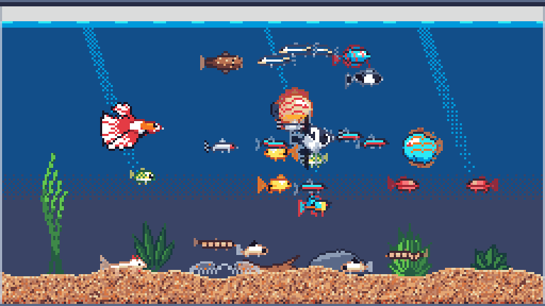
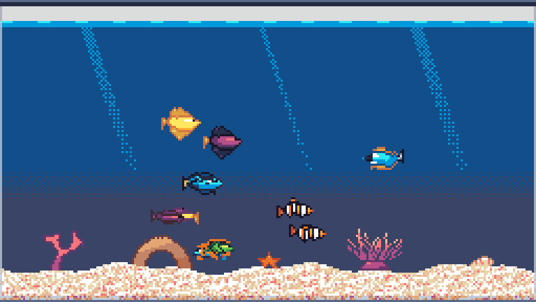

# 🐠 Pocket Reef

A tiny pixel-art aquarium that floats on your desktop, bubbles softly in the background, and lives in your menu bar (macOS) or system tray (Windows).


## ✨ Features

- 🪟 **Floating tank.** It's see-through and always on top: drag it anywhere, and resize it from the bottom-right corner.
- 🐟 **29 species, 94 colour variants**, with colours checked against photos of the real fish:
  - **Freshwater:** neon, cardinal and rummynose tetras, zebra danios, guppies, platies, mollies, cherry barbs, goldfish, orandas, bettas, dwarf gouramis, angelfish, discus, German blue rams.
  - **Bottom and glass:** corydoras, kuhli loaches, hillstream loaches, bristlenose plecos.
  - **Oddballs:** pea puffers and axolotls.
  - **Reef:** clownfish, blue and yellow tangs, royal grammas, mandarin dragonets.
  - **Clean-up crew:** cherry shrimp, ghost shrimp, snails.
- 🧠 **Real habits.** Clownfish move into anemones, royal grammas claim a rock arch, loaches and plecos cling to the glass, corydoras and axolotls dart up for air, and tetras and danios school.
- 🪸 **27 decorations and 7 floors.** Drag pieces around in decorate mode.
- 🍤 **Click to feed.** Fish get hungry, even while the app is closed, but they never die.
- 🫧 **Ambient bubbling** with volume and mute.
- 🔋 **Light on power.** The tank pauses when hidden or covered, and the UI is never throttled.
- 🚀 **Menu-bar / system-tray app** with an "open at login" option, on macOS and Windows.
- 📐 **Settings window** that adapts to any size or screen: it reflows, zooms gently, and never cuts anything off.

## 📸 Screenshots

| Fish | Decor | Tank |
|---|---|---|
|  |  |  |

| Fine sand | Rainbow gravel | Nano tank |
|---|---|---|
|  |  |  |

| Community tank | Reef tank |
|---|---|
|  |  |

## 📦 Install

Download the latest build from [Releases](https://github.com/mtom2k/pocket-reef/releases).

**🍎 macOS**
1. Open `PocketReef-<version>.dmg` and drag **Pocket Reef** to **Applications**.
2. Use the 🐠 icon in the menu bar for everything: show or hide the tank, feed, decorate, settings, quit.

> ⚠️ Builds are ad-hoc signed, so other Macs will warn about an "unidentified developer" until the app is signed with a Developer ID and notarized.

**🪟 Windows 10 and 11 (64-bit)**
- **Installer:** run `PocketReef-<version>-windows-setup.exe`. It installs for your user only (no administrator prompt), adds a Start menu shortcut and can be removed from *Settings → Apps*.
- **Portable:** run `PocketReef-<version>-windows-portable.exe` from anywhere. Nothing is installed.
- Use the 🐠 icon in the system tray (it may start in the ^ overflow; drag it to the taskbar to keep it there), or right-click the tank.

> ⚠️ The .exe files aren't code-signed yet, so SmartScreen may say "Windows protected your PC". Choose **More info → Run anyway**.

Either way, your tank is saved in `~/Library/Application Support/Pocket Reef` (macOS) or `%APPDATA%\Pocket Reef` (Windows), so it survives updates and uninstalling.

To build them yourself: `tools/release/build_macos.sh` on a Mac, or `tools/release/build_windows.ps1` on Windows (see [INSTRUCTIONS.md](INSTRUCTIONS.md)).

## 🛠️ Develop

```bash
brew install --cask godot                                  # Godot 4.7 (on Windows, install Godot 4.7 and put godot.exe on PATH)
godot --path .                                             # run it
godot --path . res://tests/smoke_test.tscn -- --save-file=user://smoke_test.json       # 115 checks (110 on Windows: the rest need macOS)
godot --path . res://tests/settings_layout.tscn -- --save-file=user://layout.json     # nothing cut off, 420×400 → 1200×900
tests/responsiveness.sh                                    # menu-bar responsiveness guard (macOS)
```

## 📚 Docs

| Doc | For |
|---|---|
| 🏗️ [ARCHITECTURE.md](ARCHITECTURE.md) | How it's built |
| 🧭 [DECISIONS.md](DECISIONS.md) | Why it's built that way |
| 📋 [INSTRUCTIONS.md](INSTRUCTIONS.md) | How to work on it (people and LLMs) |
| 🎨 [docs/style-guide.md](docs/style-guide.md) | Art rules |

## 🗺️ Status

**v0.6.0** prototype. 🍎 macOS and 🪟 Windows 11 are both tested and packaged.

**Next:** Developer ID signing on macOS, code signing on Windows, pausing a covered tank on Windows, eating animations, and tapping the glass.

---

🎨 Palette: [ENDESGA 32](https://lospec.com/palette-list/endesga-32) · 🕹️ Built with [Godot](https://godotengine.org/)
