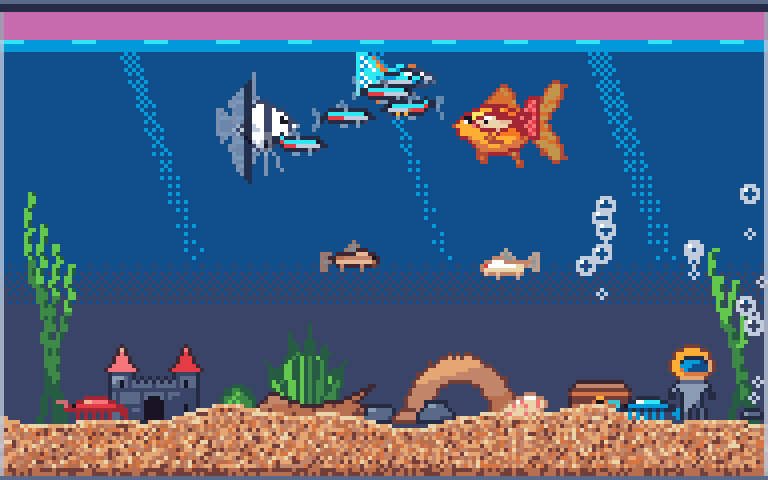

# Fishtank (working title)

A tiny pixel-art aquarium that lives on your desktop. It floats above your windows, bubbles quietly in the background, and lives in the menu bar (macOS) or system tray (Windows).



**Version:** 0.3.0 (prototype), set in `project.godot` → `application/config/version`.

## Installing (macOS)

Open `build/Fishtank-<version>.dmg` and drag **Fishtank** to **Applications**. It lives in the menu bar and has no Dock icon. Quit it from the menu.

## Running from source

You need [Godot 4.7](https://godotengine.org/) (`brew install --cask godot` on macOS).

```bash
godot --path .
```

You can also open the folder in the Godot editor and press **Play**.

| Do this | What happens |
|---|---|
| Click the water | Drops food; hungry fish race for it |
| Drag the tank | Moves it anywhere on screen (the position is remembered) |
| Drag the bottom-right corner | Resizes the tank (smallest 96×72, largest 256×144 tank pixels) |
| **Decorate mode** (menu or Settings → Decor) | The glass turns gold. Drag decorations to move them, double-click to flip, right-click to remove, Esc to finish |
| Right-click the tank | Opens the menu |
| Menu bar / tray icon | The same menu: version, show/hide tank, feed, decorate mode, mute, always on top, settings, quit |

**Settings** is a themed window, crisp on Retina and HiDPI screens and resizable, with four tabs:
- **Fish:** add or remove fish, rename them, and see how full each one is, plus stocking against the tank's capacity.
- **Decor:** decorate mode, the **floor** (7 substrates), a catalogue of 26 decorations in three groups, and the list of placed pieces (flip, remove, reset).
- **Tank:** size (presets or width × height), zoom 2×–5×, performance (Smooth 30 / Balanced 20 / Battery saver 12 fps), bubble volume, mute, always on top, open at login, recentre, and start a new tank.
- **About:** version and where the save data lives.

**Species (7):** neon tetra, goldfish, betta, guppy, corydoras, angelfish and cherry shrimp, with 15 colour variants in all. Corydoras forage on the bottom and dart up for air. Shrimp walk the gravel.

**Floors (7):** natural gravel, fine sand, coral sand, black sand, river pebbles, rainbow gravel and jade pebbles.

**Decorations (26):**
- **Plants:** tall and regular ribbon plants, hairgrass, Amazon sword, anubias, java fern, red ludwigia, moss ball.
- **Rocks & wood:** boulder, pebbles, lava rock, amethyst, rock arch, driftwood, hollow log, spider wood.
- **Ornaments:** castle, sunken ship, treasure chest, diver, clay pot cave, bubbling clam, pink coral, conch shell, starfish, air stone.

The ship, chest, diver and clam release bursts of bubbles; the air stone gives a steady stream.

## Layout

```
project.godot          window: borderless, transparent, always-on-top, 192x120 scaled by whole numbers
scenes/main.tscn       entry point
scripts/
  main.gd              the tank: layers, input (feed/drag/resize/decorate/menu), window management
  tank_renderer.gd     draws water, glass and the floor (7 substrates) for any tank size
  decor_layer.gd       decorations on the gravel: placement, hit-testing, bubble emitters
  decor_db.gd          decoration catalogue + starter layout
  fish.gd              fish behaviour: wander, school, avoid crowding, chase food
  food.gd              sinking food flakes
  tank_state.gd        autoload: settings, fish, decor, tank size; saves to user://tank.json
  species_db.gd        species data (speed, depth, stocking, variants)
  tray.gd              menu bar / tray icon + right-click menu
  settings_window.gd   native settings window (HiDPI-aware, card layout)
  ui_theme.gd          its theme: tank palette, type sizes, buttons, tabs
  tank_audio.gd        bubbler loop + pops
  login_item.gd        open at login (macOS LaunchAgent / Windows Run key)
native/macos_agent/    tiny GDExtension: menu-bar-only mode + "is the tank visible?" for macOS
tools/release/         build_macos.sh -> DMG
shaders/               swim wobble, plant sway
art/                   generated sprites (see docs/style-guide.md)
assets/audio/          generated bubble sounds
tools/spritegen/       sprite generator (Python + Pillow)
tools/audiogen/        bubble sound synthesiser (Python, standard library only)
tests/                 smoke test
```

## Packaging

```bash
tools/release/build_macos.sh    # -> build/Fishtank-<version>.dmg
```

This needs the Godot 4.7.2 export templates (Editor → Manage Export Templates, or the `.tpz` from the Godot releases page) and Xcode command-line tools. The script:
1. Builds the small native plugin in `native/macos_agent/`. Godot forces a Dock icon, and this plugin turns the app into a menu-bar-only app, but only inside the exported bundle.
2. Exports a universal (Apple Silicon + Intel), ad-hoc signed `.app`.
3. Wraps it in a drag-to-Applications DMG.

**Signing:** the build is only ad-hoc signed. It runs on the Mac that built it, but other Macs will warn about an "unidentified developer" until it's signed with an Apple Developer ID and notarized.

**Version** comes from `project.godot`, and the bundle id is `dev.fishtank.app` (a placeholder until the app has a name).

## Regenerating assets

```bash
uv run --with pillow tools/spritegen/export_godot.py   # fish, decorations, bubbles, icons
python3 tools/audiogen/bubbles.py                      # bubble sounds
```

## Tests

```bash
godot --path . res://tests/smoke_test.tscn -- --save-file=user://smoke_test.json
```

The smoke test boots the real tank and drives every setting and menu path: resize, hide/show, always on top, mute, stocking rules, adding/removing fish, feeding from the menu, the settings window, and saving. On macOS it also takes real screen captures to check that a hidden tank actually disappears from the screen. It refuses to run against your real save file.

```bash
tests/responsiveness.sh
```

This (macOS) launches a hidden tank and fails if it takes more than 600 ms to answer system events. It guards against the menu-bar freeze from v0.2.2.

**Debug flags** (after `--`):
- `--screenshot=PATH` saves a frame after 3 s and quits.
- `--debug-feed` drops food.
- `--debug-settings[=TAB]` opens the settings window on that tab.

## Design notes

- **Fish never die.** Hunger rises over about 4 hours, including while the app is closed. Starving fish only get sluggish.
- **New tanks** start with one goldfish and a starter layout (two ribbon plants, hairgrass, a boulder and an air stone).
- **Stocking:** a standard tank holds 24 points, and capacity scales with tank area (a nano tank holds 7). Points per fish: shrimp 0; tetra, guppy and corydoras 1; betta 3; angelfish 5; goldfish 6. Only one betta per tank, because they fight. Shrinking an already-full tank is allowed; it just shows "overstocked" and blocks new fish.
- **Small tanks:** tall plants are trimmed so they just reach the surface.
- **Save format 2** (v0.2) adds decor and tank size. v0.1 saves are migrated automatically: your fish are kept and the starter decor is added.
- **Hiding the tank** makes it invisible and click-through, and pauses the fish (they still get hungry). On macOS it also stops drawing, after first drawing the empty window so no frozen tank is left on screen. Godot can't hide its main window, and this way the bubbling carries on in the background.
- **Idle never goes below 10 ticks a second.** Godot's frame cap sleeps the main thread, and macOS needs that thread to answer menu-bar clicks. At 1 tick a second (v0.2.1–0.2.2) the whole menu bar stalled. Any open menu gets 60 ticks a second. The native plugin also opts out of App Nap and timer coalescing, which otherwise stretch those sleeps. `tests/responsiveness.sh` guards this.
- **Auto-pause when nobody can see the tank (macOS).** Covered by another window, behind a fullscreen app, on another Space, or with the screen locked or asleep. The native plugin listens for macOS's window-visibility notifications and sets `FISHTANK_OCCLUDED`, which `main.gd` polls. While covered, the tank idles like a hidden one (10 ticks a second, nothing drawn, fish paused but still getting hungry, bubbles still audible) and wakes within about a second of becoming visible again. It isn't implemented on Windows yet.

## Performance

`tests/perf_probe` boots the real tank in a scenario and reports its own CPU use and memory:

```bash
godot --path . res://tests/perf_probe.tscn -- --save-file=user://perf.json --scenario=busy --performance=balanced
```

Results on an M2 Pro (CPU % of one core; budget for roughly 4–6× on low-end machines). "Busy" is 41 fish, 16 decorations and the largest tank.

| Scenario | v0.2.0 (30 fps) | v0.2.1 default (20 fps) | Battery saver (12 fps) |
|---|---|---|---|
| Starter tank | 9.9% | 6.9% | 4.6% |
| Busy tank | 17.0% | 10.7% | 7.3% |
| Hidden | 3.6% | 1.2% (0.7% in v0.2.2, but that froze the menu bar) | — |
| Covered | same as visible | 1.2% | — |

**What helps:**
- Fewer frames per second; engine overhead scales with frame rate.
- Fish make decisions 10 times a second, staggered across fish, while still moving every frame.
- The fish list is cached instead of being rebuilt each time.
- All bubbles are drawn by one node.
- Physics runs at 10 ticks a second and audio mixes at 22 kHz.

**What doesn't:** zoom level and draw calls (both cheap). Godot's Metal renderer is worse here (more CPU, about 95 MB more memory), so the project stays on the Compatibility renderer.

## Platform status

| | macOS | Windows |
|---|---|---|
| Transparent overlay + drag | ✅ tested | ⚠️ not tested yet |
| Menu bar / tray icon | ✅ tested | ⚠️ not tested yet (Godot supports it) |
| HiDPI scaling | ✅ Retina | ⚠️ uses monitor DPI ÷ 96, needs checking on 125%/150% displays |
| Open at login | ✅ LaunchAgent (create/validate/remove tested) | ⚠️ Run registry key, not tested yet |
| Packaged app | ✅ DMG, menu-bar only, ad-hoc signed | ❌ no installer yet |
| Auto-pause when covered | ✅ tested (window moved off-screen) | ❌ not yet |

## Next up

- Windows `.exe` and installer; Developer ID signing and notarization for macOS.
- Placing decorations, more species, eating animation, tapping the glass.
