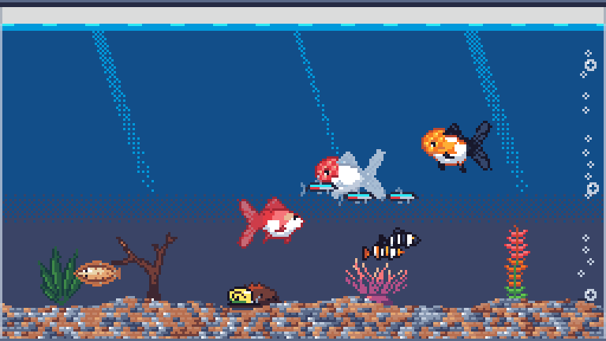
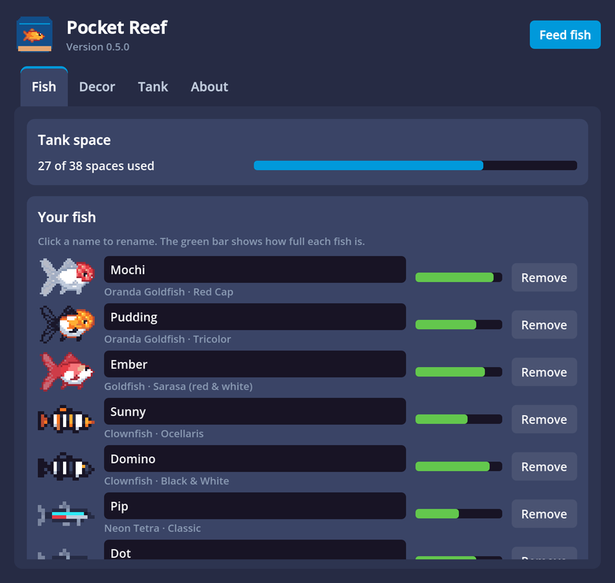
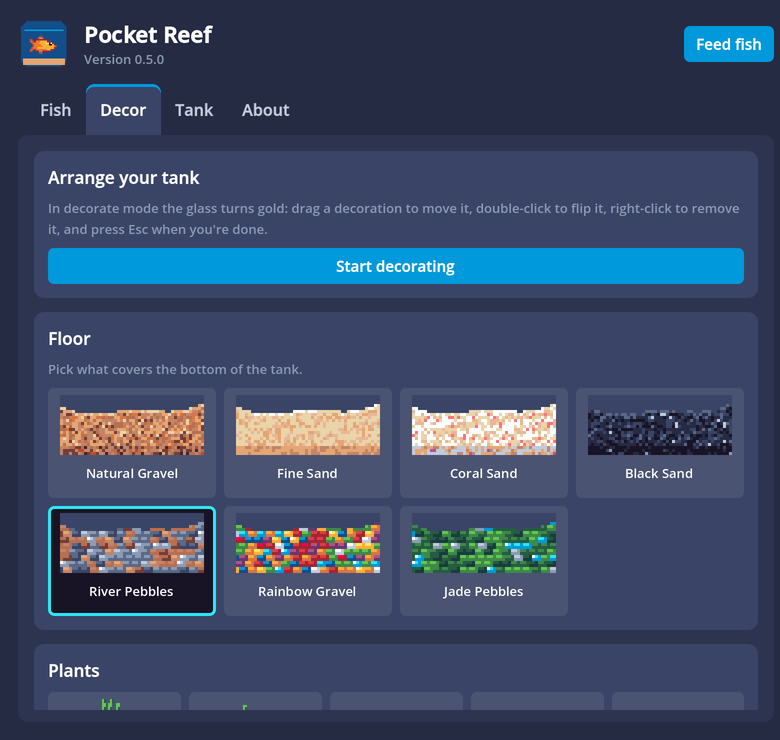
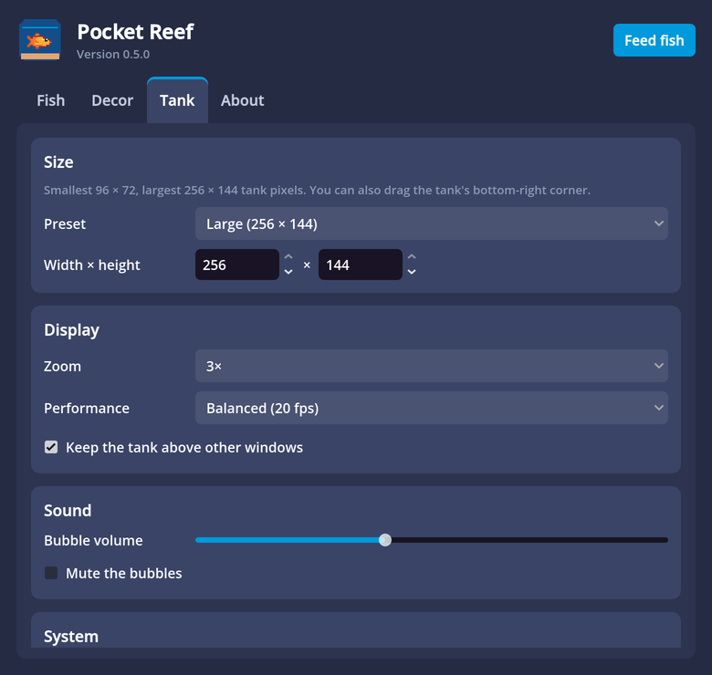
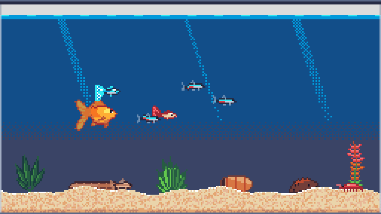
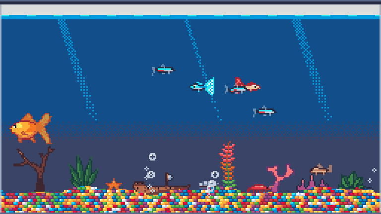
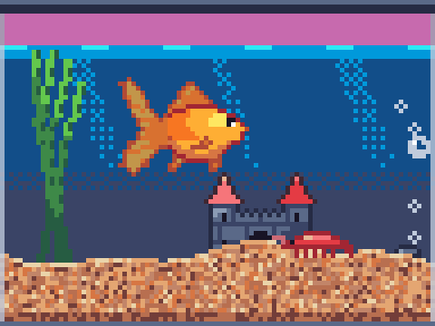

# 🐠 Pocket Reef

A tiny pixel-art aquarium that floats on your desktop, bubbles softly in the background, and lives in your menu bar.



## ✨ Features

- 🪟 **Floating tank.** It's see-through and always on top: drag it anywhere, and resize it from the bottom-right corner.
- 🐟 **11 species, 32 colour variants:** goldfish, oranda goldfish, clownfish, betta, angelfish, guppies, neon tetras, corydoras, hillstream loaches, cherry shrimp and snails.
- 🧠 **Real habits.** Clownfish move into anemones, loaches cling to the glass, corydoras dart up for air, and tetras school.
- 🪸 **27 decorations and 7 floors.** Drag pieces around in decorate mode.
- 🍤 **Click to feed.** Fish get hungry, even while the app is closed, but they never die.
- 🫧 **Ambient bubbling** with volume and mute.
- 🔋 **Light on power.** The tank pauses when hidden or covered, and the UI is never throttled.
- 🚀 **Menu-bar app** with an "open at login" option.

## 📸 Screenshots

| Fish | Decor | Tank |
|---|---|---|
|  |  |  |

| Fine sand | Rainbow gravel | Nano tank |
|---|---|---|
|  |  |  |

## 📦 Install (macOS)

1. Build the disk image with `tools/release/build_macos.sh` (it appears at `build/PocketReef-<version>.dmg`).
2. Open it and drag **Pocket Reef** to **Applications**.
3. Use the 🐠 icon in the menu bar for everything: show or hide the tank, feed, decorate, settings, quit.

> ⚠️ Builds are ad-hoc signed, so other Macs will warn about an "unidentified developer" until the app is signed with a Developer ID and notarized.

## 🛠️ Develop

```bash
brew install --cask godot                                  # Godot 4.7
godot --path .                                             # run it
godot --path . res://tests/smoke_test.tscn -- --save-file=user://smoke_test.json   # 105 checks
tests/responsiveness.sh                                    # menu-bar responsiveness guard
```

## 📚 Docs

| Doc | For |
|---|---|
| 🏗️ [ARCHITECTURE.md](ARCHITECTURE.md) | How it's built |
| 🧭 [DECISIONS.md](DECISIONS.md) | Why it's built that way |
| 📋 [INSTRUCTIONS.md](INSTRUCTIONS.md) | How to work on it (people and LLMs) |
| 🎨 [docs/style-guide.md](docs/style-guide.md) | Art rules |

## 🗺️ Status

**v0.5.0** prototype. 🍎 macOS is tested; 🪟 Windows builds but hasn't been tested yet.

**Next:** a Windows build, Developer ID signing, eating animations, and tapping the glass.

---

🎨 Palette: [ENDESGA 32](https://lospec.com/palette-list/endesga-32) · 🕹️ Built with [Godot](https://godotengine.org/)
