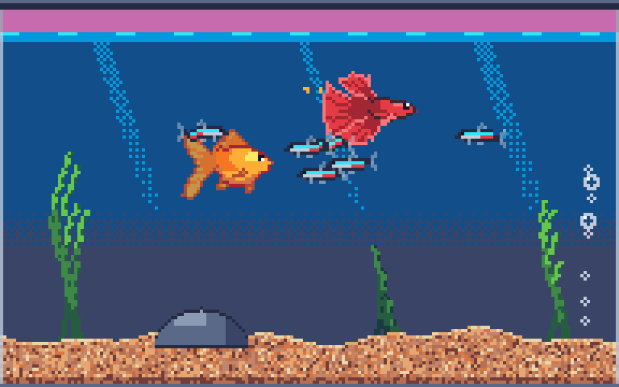

# Fishtank (working title)

A tiny pixel-art aquarium that lives on your desktop. It floats above your windows, bubbles quietly in the background, and lives in the menu bar (macOS) or system tray (Windows).



**Version:** 0.1.0 (prototype), set in `project.godot` → `application/config/version`.

## Installing (macOS)

Open `build/Fishtank-<version>.dmg` and drag **Fishtank** to **Applications**. It lives in the menu bar and has no Dock icon. Quit it from the menu.

## Running from source

You need [Godot 4.7](https://godotengine.org/) (`brew install --cask godot` on macOS).

```bash
godot --path .
```

You can also open the folder in the Godot editor and press **Play**.

| Do this | What happens |
|---|---|
| Click the water | Drops food; hungry fish race for it |
| Drag the tank | Moves it anywhere on screen (the position is remembered) |
| Right-click the tank | Opens the menu |
| Menu bar / tray icon | The same menu: version, show/hide tank, feed, mute, always on top, settings, quit |

**Settings** has three tabs:
- **Fish:** add or remove fish, rename them, and see how full each one is, plus overall tank stocking.
- **Tank:** size 2×–5×, bubble volume, mute, always on top, **open at login**, and recentring the tank.
- **About:** version and where the save data lives.

## Layout

```
project.godot          window: borderless, transparent, always-on-top, 192x120 scaled by whole numbers
scenes/main.tscn       entry point
scripts/
  main.gd              the tank: layers, input (feed/drag/menu), window management
  fish.gd              fish behaviour: wander, school, avoid crowding, chase food
  food.gd              sinking food flakes
  tank_state.gd        autoload: settings + fish roster, saves to user://tank.json
  species_db.gd        species data (speed, depth, stocking, variants)
  tray.gd              menu bar / tray icon + right-click menu
  settings_window.gd   native settings window
  tank_audio.gd        bubbler loop + pops
  login_item.gd        open at login (macOS LaunchAgent / Windows Run key)
native/macos_agent/    tiny GDExtension: menu-bar-only mode for the exported Mac app
tools/release/         build_macos.sh -> DMG
shaders/               swim wobble, plant sway
art/                   generated sprites (see docs/style-guide.md)
assets/audio/          generated bubble sounds
tools/spritegen/       sprite generator (Python + Pillow)
tools/audiogen/        bubble sound synthesiser (Python, standard library only)
tests/                 smoke test
```

## Packaging

```bash
tools/release/build_macos.sh    # -> build/Fishtank-<version>.dmg
```

This needs the Godot 4.7.2 export templates (Editor → Manage Export Templates, or the `.tpz` from the Godot releases page) and Xcode command-line tools. The script:
1. Builds the small native plugin in `native/macos_agent/`. Godot forces a Dock icon, and this plugin turns the app into a menu-bar-only app, but only inside the exported bundle.
2. Exports a universal (Apple Silicon + Intel), ad-hoc signed `.app`.
3. Wraps it in a drag-to-Applications DMG.

**Signing:** the build is only ad-hoc signed. It runs on the Mac that built it, but other Macs will warn about an "unidentified developer" until it's signed with an Apple Developer ID and notarized.

**Version** comes from `project.godot`, and the bundle id is `dev.fishtank.app` (a placeholder until the app has a name).

## Regenerating assets

```bash
uv run --with pillow tools/spritegen/export_godot.py   # fish, tank layers, icons
python3 tools/audiogen/bubbles.py                      # bubble sounds
```

## Tests

```bash
godot --path . res://tests/smoke_test.tscn -- --save-file=user://smoke_test.json
```

This boots the real tank and drives every setting and menu path: resize, hide/show, always on top, mute, stocking rules, adding/removing fish, feeding from the menu, the settings window, and saving. It refuses to run against your real save file.

**Debug flags** (after `--`):
- `--screenshot=PATH` saves a frame after 3 s and quits.
- `--debug-feed` drops food.
- `--debug-settings[=TAB]` opens the settings window on that tab.

## Design notes

- **Fish never die.** Hunger rises over about 4 hours, including while the app is closed. Starving fish only get sluggish.
- **Stocking:** the tank holds 24 points (tetra 1, betta 3, goldfish 6). Only one betta per tank, because they fight.
- **Hiding the tank** makes it invisible and click-through, and drops it to 5 fps. Godot can't hide its main window, and this way the bubbling carries on in the background.
- Runs at 30 fps on the lightweight Compatibility renderer, to be kind to battery life.

## Platform status

| | macOS | Windows |
|---|---|---|
| Transparent overlay + drag | ✅ tested | ⚠️ not tested yet |
| Menu bar / tray icon | ✅ tested | ⚠️ not tested yet (Godot supports it) |
| HiDPI scaling | ✅ Retina | ⚠️ uses monitor DPI ÷ 96, needs checking on 125%/150% displays |
| Open at login | ✅ LaunchAgent (create/validate/remove tested) | ⚠️ Run registry key, not tested yet |
| Packaged app | ✅ DMG, menu-bar only, ad-hoc signed | ❌ no installer yet |

## Next up

- Windows `.exe` and installer; Developer ID signing and notarization for macOS.
- Placing decorations, more species, eating animation, tapping the glass.
