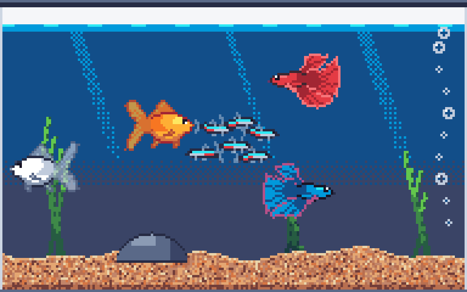

# Art Style Guide (v0.1 — draft)



**Look in one line:** cozy, saturated 2D pixel art that stays readable when the tank is shrunk to a small window on someone's desktop.

## 1. Canvas & scale

| Thing | Rule |
|---|---|
| Tank | **Resizable**, in 8 px steps, from **96 × 72** to **256 × 144** (presets: Nano 96×72, Small 128×88, Standard 192×120, Large 256×144). The water surface is always at y = 10 and the gravel is always 16 px deep. |
| Display | Integer scaling only (2×–5×, user-selectable), nearest-neighbour filtering |
| Positions | Fish may move at sub-pixel speed internally, but always **render snapped to whole pixels** |
| Facing | All sprites are drawn **facing right**; facing left is a horizontal flip |

## 2. Palette

Use only **[ENDESGA 32](https://lospec.com/palette-list/endesga-32)**. The file is `art/palette/fishtank.gpl`, which Aseprite loads via Palette → Load. Colour names live in `tools/spritegen/palette.py`.

| Role | Colours |
|---|---|
| Water (surface → deep) | `cyan` shimmer, `sky`, `deep_blue`, `dusk` |
| Gravel | `sand`, `wood`, `tan`, `clay`, `cream` highlights, `bark` depth |
| Plants | `abyss_green` → `pine` → `moss` → `leaf` (base → tip) |
| Rocks / glass | `navy`, `dusk`, `slate`, `steel`, `silver` |
| Darkest allowed | `ink` (#181425). **Never pure black.** |

**Transparency** is allowed only for fins (alpha 150–235), glass (40–200) and light effects. Everything else is fully opaque.

## 3. Sizes

Small fish are drawn slightly larger than true scale so they stay readable. Fish should also differ clearly in **silhouette**, not just colour.

| Class | Size | Example |
|---|---|---|
| Tiny | ≤ 18 × 6 | Cherry shrimp 18 × 6 |
| Small | 12–18 × 5–11 | Neon tetra 16 × 7, Corydoras 15 × 8, Guppy 17 × 11 (a big tail is the point) |
| Medium | 24–32 × 16–27 | Goldfish 30 × 21, Betta 30 × 23, Angelfish 22 × 27 (tall) |

## 4. Lighting & shading

- Light comes **from the water surface**. Each fish's brightest spot is on its **upper front** (behind the head), and the body falls off toward the tail and belly.
- **Countershading:** bellies are paler (the `B` region). This is both realistic and what makes fish look round.
- Each body uses a 5-step ramp: `outline → shadow → mid → light → highlight`.
- **No smooth gradients anywhere.** Use solid bands, with **4 × 4 ordered (Bayer) dithering** where bands meet.

## 5. Outlines

- **Selective, coloured outlines.** A body is outlined in the darkest shade of its own hue: crimson around orange, navy around silver. Use `ink` only for already-dark fish.
- Fins use a lighter or hue-shifted outline than the body. For example, the betta's red fins are edged in `salmon`, which gives a glowing tip.
- **Layering:** tail (`f`) → dorsal/anal (`g`) → body → pectoral/pelvic (`h`). A front layer gets an outline wherever it overlaps a layer behind it. The body is outlined against fins above and below it, but **not** at the tail join.

## 6. Faces

- **Small fish:** a 1 px `ink` eye.
- **Medium and larger:** a 2 × 2 eye made of 3 `ink` pixels and 1 `white` highlight in the **top-right** corner. That highlight is what makes them look cute and alive.
- **Mouth:** 1 px at the front tip in the body's shadow colour.

## 7. Fins

- Fins have **1 px rays** fanning out from where they meet the body. They are darker near the root, lighter toward the edge, and may be slightly translucent.
- Flowing fins (betta, fancy goldfish) should be large and expressive. They are the character of the species.

## 8. Animation

- Each species has **one idle sprite**. A shader in Godot animates it:
  - **Swim wobble:** pixel columns bob vertically, more toward the tail. See `art/previews/tank_swim.gif`.
  - **Bob:** a slow ±1 px vertical drift.
  - **Turn:** a flip, optionally with a 1-frame "squash" sprite.
- Hand-drawn frames only for special moments: eat (2 frames, mouth open), happy wiggle, sleepy.
- Plants use the same column-offset shader to sway.

## 9. Environment

- **Water:** dithered bands as described above; a `cyan`/`sky` surface line; faint slanted light shafts that fade with depth.
- **Gravel:** noisy mix of the sand tones, a lighter top edge, darker toward the glass bottom.
- **Overlay mode:** the tank needs a **glass frame plus a dark rim** so it reads as an object on any wallpaper. The air gap above the water is a faint glass tint, so the desktop shows through.

## 10. Decorations

- Drawn by `tools/spritegen/decor.py` with the same rules: light from above, coloured outlines, and a shadow tone wherever one part sits on top of another (roofs on towers, gold bands on the chest).
- **Textures:** bricks on stone and planks on wood come from simple per-pixel patterns, not hand-placed pixels, so pieces can be resized consistently.
- **Placement:** pieces sit on the gravel, sunk 1–3 px into it, and taller pieces draw behind shorter ones. Plants sway using the same shader idea as the fish wobble.
- **Bubble makers:** the air stone gives a steady stream; the chest, diver, sunken ship and clam give an occasional burst.
- **Procedural pieces:** spider wood and coral grow from a seeded branching routine, and anubias and java fern are lens-shaped leaves fanned from a base.
- **Floors** (`scripts/tank_renderer.gd`), in three styles:
  - *Speckle:* mixed grains (natural gravel, black sand).
  - *Sand:* fine grains with soft ripples (fine sand, coral sand).
  - *Pebbles:* staggered 3×2 stones with a darker bottom and right edge and an occasional highlight (river, rainbow, jade).

  All floors are hash-based, so resizing the tank never reshuffles them.

## 10b. Settings window

- **Same palette as the tank:** navy background, dusk cards, sky-blue accent, salmon for warnings, leaf green for "full".
- **Type:** 15 px body, 17 px section titles, 22 px window title, 13 px hints. These are logical pixels, doubled on Retina.
- **HiDPI:** the window uses the `canvas_items` content scale with the screen's scale factor, so text is crisp, and resizing reflows the layout instead of zooming it.

## 11. Colour variants (morphs)

A morph reuses a species' silhouette with a different colour ramp (see the `variants` in `tools/spritegen/species.py`). Current examples: goldfish **default / calico**, betta **red / royal blue**. This makes "collect colour morphs" an inexpensive feature to add.

## 12. Pipeline

```
tools/spritegen/
  palette.py   ENDESGA 32 + .gpl export
  render.py    silhouette → shaded, outlined sprite (all shading rules live here)
  species.py   ASCII silhouettes, fin roots, colour variants
  build.py     → art/sprites/fish/*.png, art/previews/fish_sheet.png
  decor.py     → art/decor/*.png, art/previews/decor_sheet.png
  scene.py     → art/previews/tank_preview.png, tank_swim.gif (mock-ups only)
  export_godot.py  everything the game uses (fish, decor, bubbles, icons)
```

```bash
uv run --with pillow tools/spritegen/scene.py
```

**Adding a species:**
1. Draw an ASCII silhouette in `species.py`. The legend is in `render.py`.
2. Set `fin_roots` and the colour ramps.
3. Rebuild and review the preview sheet.
4. Optionally hand-polish the PNG in Aseprite.

> Note: hand-polished PNGs are overwritten by the next build, so a polished sprite should be moved out of the generated set first. (TODO: add a `manual/` override folder.)

## Open questions

- Should the deep water go darker (`navy`) for more contrast, or stay `dusk`?
- Betta body vs fin ratio: currently realistic, with a small body and huge fins. A cuter, bigger-headed version is possible.
- Should the overlay tank be a separate, smaller crop (128 × 80) or the same tank scaled down?
